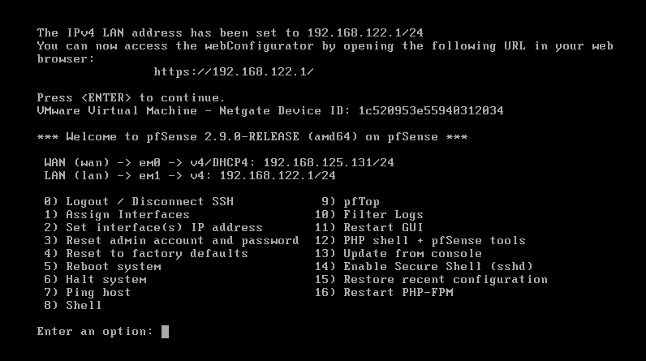
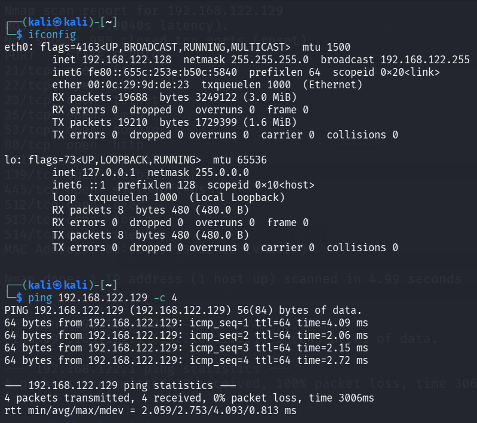
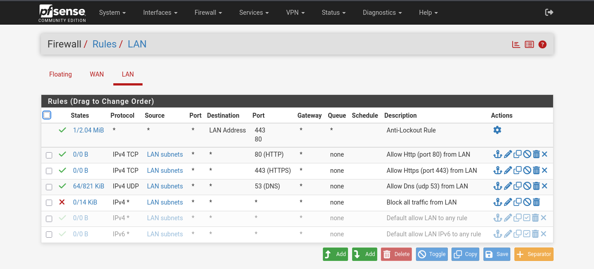
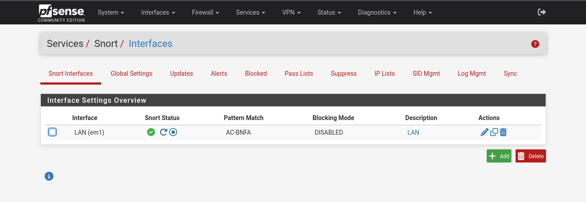
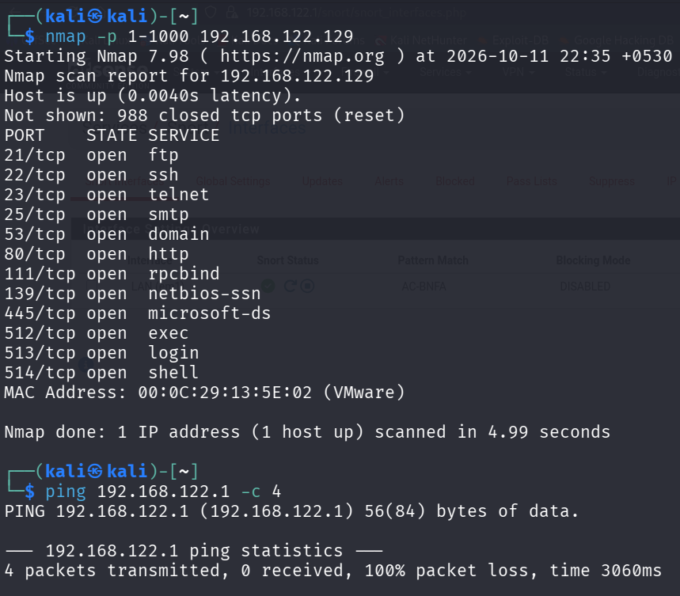
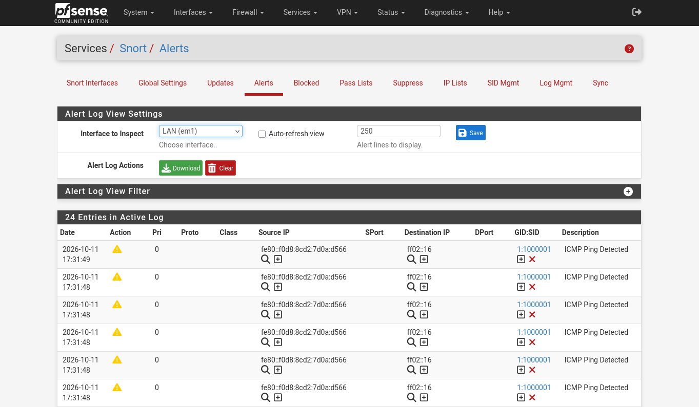

# Experiment 4: Firewall and IDS Setup

## Objective

Configure firewall rules with pfSense and enable Snort to monitor an isolated lab network for suspicious activity.

## Lab Requirements

- pfSense virtual machine with WAN and LAN interfaces
- Kali Linux and a designated test machine on the lab network
- An isolated host-only or otherwise private virtual network

Only scan systems you own or have explicit permission to test. Confirm the pfSense management interface remains reachable before applying firewall changes.

## Procedure

### 1. Verify pfSense interfaces

Start pfSense and confirm the WAN and LAN interfaces have the expected addresses. Verify that the LAN is attached to the isolated lab network.



### 2. Check connectivity from Kali

On Kali, identify the active interface and verify connectivity to the designated test machine.

```bash
ip addr
ping -c 4 <target-ip>
```



### 3. Configure firewall rules

In the pfSense web interface, open **Firewall → Rules → LAN**. Add or adjust rules to permit only the services required for the lab and block unneeded traffic. Apply changes and confirm the intended traffic is allowed or blocked.



### 4. Enable Snort

Open **Services → Snort → Interfaces**, enable monitoring on the LAN interface, select the appropriate rule sets, and confirm that Snort is running.



### 5. Generate and inspect test traffic

From Kali, run a limited connectivity check against the authorized test machine and review the firewall logs and Snort alerts.

```bash
ping -c 4 <target-ip>
nmap -p 1-1000 <target-ip>
```



### 6. Review alerts

In pfSense, open **Services → Snort → Alerts**. Record whether the test traffic generated alerts and compare those events with the configured firewall rules.



## Result

Firewall rules were configured in pfSense and Snort monitored the lab interface. The generated test traffic and any corresponding alerts were reviewed.

## Conclusion

This experiment demonstrates how network filtering and intrusion detection complement each other. Firewall rules control which traffic is permitted, while Snort inspects monitored traffic for events that match its detection rules.