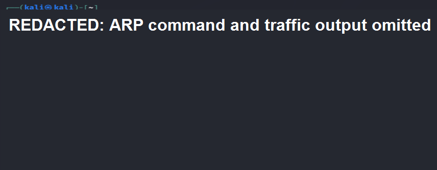
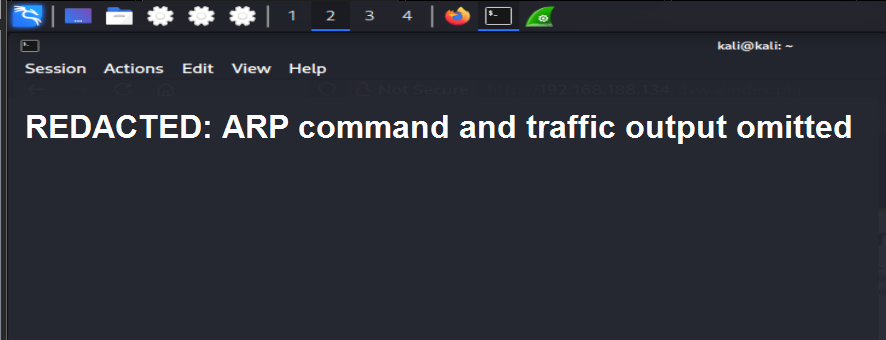
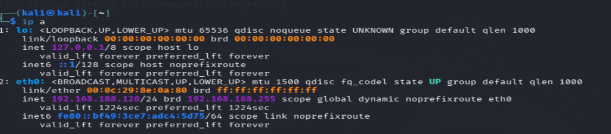
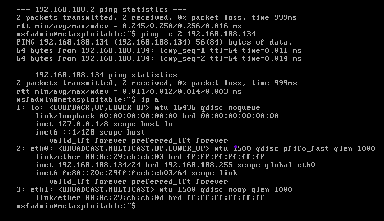
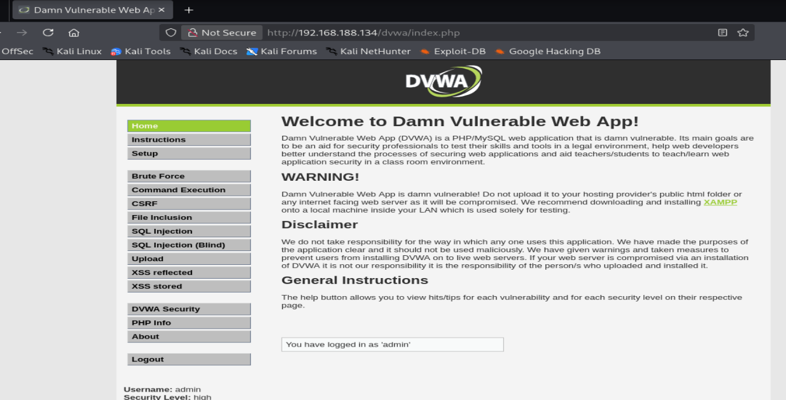
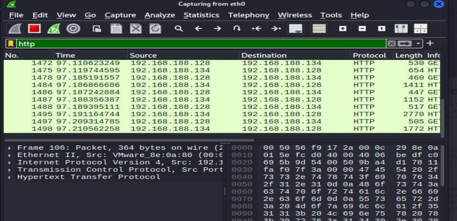

# Experiment 5: Sniffing and HTTP Traffic Analysis

## Objective

Observe HTTP traffic in an isolated virtual lab and examine why unencrypted web sessions expose sensitive information. The exercise is limited to traffic generated by your own lab machines and test account; it does not attempt to intercept or reuse another user's session.

## Lab Requirements

- Kali Linux with Wireshark
- DVWA or another intentionally vulnerable web application hosted in your isolated lab
- A private host-only or otherwise isolated virtual network
- A disposable test account with no reused credentials

## Redacted Reference Screenshots

The following upstream screenshots are included with the ARP commands and resulting traffic output obscured. They are provided as redacted lab evidence, not as instructions to redirect network traffic.





## Procedure

### 1. Verify the lab network

On Kali, identify the active lab interface and confirm that the web application is reachable. Use the lab's assigned addresses rather than public targets.

```bash
ip addr
ping -c 2 <target-ip>
```





### 2. Start a packet capture

Open Wireshark and select the interface connected to the isolated lab network. Start capturing before generating test web traffic. If needed, apply a capture filter limited to the lab host:

```text
host <target-ip>
```

### 3. Generate ordinary test traffic

In a browser on Kali, visit the DVWA instance over HTTP and sign in using only the disposable lab account. Navigate to a page and then sign out. Do not use real credentials or copy session tokens.



### 4. Inspect HTTP packets

Stop the capture and use the Wireshark display filter `http` to locate the requests and responses generated by the test session. Inspect the packet metadata and observe which data is visible because the connection is unencrypted. Do not export or reuse authentication cookies.



## Result

The capture showed that HTTP traffic can expose request and response data to a party able to observe the network. The exercise demonstrates the risk of transmitting sensitive information without transport encryption.

## Conclusion

Use HTTPS throughout a web application, enable secure session-cookie attributes such as `Secure` and `HttpOnly`, and avoid transmitting credentials over plaintext protocols. Packet captures should remain within the authorized lab and be deleted when no longer needed.